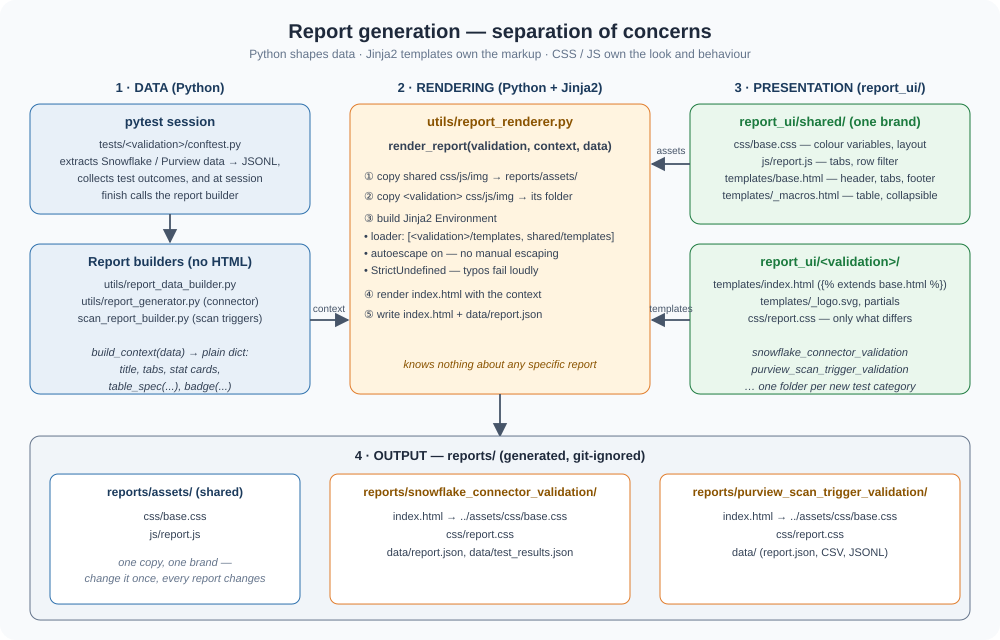

# purview-snowflake-validator

A **browser-free Python test framework** that validates whether a Microsoft Purview Snowflake Connector has correctly ingested Snowflake metadata — and flags drift in both directions.

[](https://www.python.org/)
[](https://pytest.org/)
[](LICENSE)

---

## Table of Contents

- [How It Works](#how-it-works)
- [Comparison Logic](#comparison-logic)
- [MS Purview APIs and SDKs](#ms-purview-apis-and-sdks)
- [Project Layout](#project-layout)
- [Quick Start](#quick-start)
- [Database Exclusions](#database-exclusions)
- [HTML Report](#html-report)
- [Report Generation Architecture](#report-generation-architecture)
- [CI/CD](#cicd)
- [Developer Notes](#developer-notes)

---

## How It Works

```
┌─────────────────────────────────────────────────────────────────────┐
│              BeforeAll hook  (conftest.py session fixture)          │
│                                                                     │
│  STEP 1  Connect Snowflake  → fail → pytest.exit()  (no tests run) │
│  STEP 2  Connect Purview    → fail → pytest.exit()  (no tests run) │
│                                                                     │
│  STEP 3  Extract from Snowflake ACCOUNT_USAGE (SQL = query.sql)     │
│          databases · schemas · tables · views                       │
│          columns · stored_procedures  →  data/snowflake_connector_validation/snowflake_data_validation/              │
│                                                                     │
│  STEP 4  Extract from MS Purview Catalog + Atlas Entity API         │
│          same 6 entity types; columns via referredEntities          │
│          →  data/snowflake_connector_validation/purview_data_validation/                                          │
└──────────────────────────────────┬──────────────────────────────────┘
                                   │  data fully on disk
                                   ▼
┌─────────────────────────────────────────────────────────────────────┐
│                     pytest tests (comparison only)                  │
│                                                                     │
│  test_databases.py          bidirectional DB diff                   │
│  test_schemas.py            bidirectional schema diff               │
│  test_tables.py             bidirectional table diff                │
│  test_views.py              bidirectional view diff                 │
│  test_columns.py            bidirectional column diff               │
│                             + empty description audit (info only)   │
│  test_stored_procedures.py  bidirectional stored proc diff          │
└──────────────────────────────────┬──────────────────────────────────┘
                                   │  session finish hook
                                   ▼
┌─────────────────────────────────────────────────────────────────────┐
│           Tabbed HTML report  (reports/snowflake_connector_validation/index.html)                  │
│                                                                     │
│  📊 Overview  |  🗄️ Databases  |  📂 Schemas  |  📋 Tables         │
│  👁️ Views     |  🔠 Columns    |  ⚙️ Stored Procedures              │
│                                                                     │
│  Each entity tab has three collapsible subsections (hidden by       │
│  default, click ▶ to expand):                                       │
│    In Snowflake — NOT in Purview                                    │
│    In Purview — NOT in Snowflake                                    │
│    Empty Description in Purview                                     │
│  Large result sets are paginated at 50 rows per page.               │
└─────────────────────────────────────────────────────────────────────┘
```

---

## Comparison Logic

The comparison is a **bidirectional set diff** performed for each of the six entity types. Understanding this logic helps interpret the report correctly.

### Step 1 — Build canonical keys

Each record from Snowflake and each record from Purview is reduced to a single, normalised string key. All keys are **uppercased** so comparison is case-insensitive.

| Entity | Snowflake key (from `data/snowflake_connector_validation/snowflake_data_validation/`) | Purview key (parsed from `qualifiedName`) |
|--------|-------------------------------------|-------------------------------------------|
| Database | `DATABASE_NAME` | `.../databases/<DB>` |
| Schema | `DATABASE_NAME.SCHEMA_NAME` | `.../databases/<DB>/schemas/<SCHEMA>` |
| Table | `TABLE_CATALOG.TABLE_SCHEMA.TABLE_NAME` | `.../databases/<DB>/schemas/<SCHEMA>/tables/<TABLE>` |
| View | `TABLE_CATALOG.TABLE_SCHEMA.TABLE_NAME` | `.../databases/<DB>/schemas/<SCHEMA>/views/<VIEW>` |
| Column | `TABLE_CATALOG.TABLE_SCHEMA.TABLE_NAME.COLUMN_NAME` | `.../tables/<TABLE>/columns/<COL>` |
| Stored Procedure | `PROCEDURE_CATALOG.PROCEDURE_SCHEMA.PROCEDURE_NAME` | `.../databases/<DB>/schemas/<SCHEMA>/procedures/<SP>` |

Purview stores every asset's `qualifiedName` as a URI of the form:

```
snowflake://account.snowflakecomputing.com/databases/MY_DB/schemas/MY_SCHEMA/tables/MY_TABLE
```

The `parse_qualified_name()` function in `utils/comparator.py` splits this URI on `/` and extracts each segment by its preceding path keyword (`databases`, `schemas`, `tables`, `views`, `columns`).

### Step 2 — Compute the diff

```
sf_keys  = { key(r) for r in snowflake_records }
pv_keys  = { key(r) for r in purview_records   }

missing_from_purview = sf_keys - pv_keys   # in Snowflake but NOT in Purview
extra_in_purview     = pv_keys - sf_keys   # in Purview but NOT in Snowflake
```

### Step 3 — Assert

Each pytest test asserts one direction of the diff:

- `test_all_snowflake_<entity>_exist_in_purview` — fails if `missing_from_purview` is non-empty.  
  These are objects the Purview connector has **not ingested** yet.
- `test_no_extra_<entity>_in_purview` — fails if `extra_in_purview` is non-empty.  
  These are objects present in Purview that **no longer exist** in Snowflake (stale / orphaned assets).

### Step 4 — Empty description audit

After the diff, every Purview JSONL file is scanned for records where the `description` field is absent or blank. These are surfaced per entity type in the HTML report as an informational table (not a test failure, but a data-quality indicator).

### Why JSONL and not live API calls in tests?

Extraction happens **once** in the BeforeAll hook and writes JSONL files. All test functions then read only from those local files — there are no live cloud calls during test execution. This means:

- Tests run in milliseconds regardless of dataset size.
- Re-running the report (`python scripts/refresh_report.py`) does not require re-connecting to Snowflake or Purview.
- The JSONL snapshots are uploaded as CI artifacts for auditing.

---

## MS Purview APIs and SDKs

`clients/purview_client.py` uses the following interfaces. All endpoints are relative to `https://<account_name>.purview.azure.com`.

### Authentication

| Library | Usage |
|---------|-------|
| [`azure-identity`](https://pypi.org/project/azure-identity/) — `ClientSecretCredential` | Obtains an OAuth 2.0 bearer token for the scope `https://purview.azure.net/.default` using a service principal (client ID + secret + tenant ID). The token is refreshed automatically per request. |
| [`azure-purview-catalog`](https://pypi.org/project/azure-purview-catalog/) — `PurviewCatalogClient` | Used for client construction / endpoint wiring. Actual HTTP calls are made directly via `requests` for full control over retries and pagination. |

### REST Endpoints Called

#### 1. List collections
```
GET /account/collections
    ?api-version=2019-11-01-preview
```
Retrieves all collections in the Purview account. Used once at startup to resolve the machine reference name of the target sub-collection (e.g. `Commercial`) by matching `friendlyName` and walking the parent chain.

Reference: [Collections API — List](https://learn.microsoft.com/en-us/rest/api/purview/accountdataplane/collections/list-collections)

#### 2. Search entities (Catalog Search API)
```
POST /catalog/api/search/query
     ?api-version=2022-08-01-preview

Body:
{
  "filter": {
    "and": [
      { "entityType": "snowflake_database" },
      { "collectionId": "<reference_name>" }
    ]
  },
  "limit": 1000,
  "offset": 0
}
```
Used to extract **databases, schemas, tables, views, and stored procedures**. Paginated — successive calls increment `offset` by `limit` until a partial page is returned.

Entity types searched: `snowflake_database`, `snowflake_schema`, `snowflake_table`, `snowflake_view`, `snowflake_procedure`.

Reference: [Catalog Search — Query](https://learn.microsoft.com/en-us/rest/api/purview/catalogdataplane/discovery/query)

#### 3. Bulk entity fetch (Atlas Entity API)
```
GET /catalog/api/atlas/v2/entity/bulk
    ?minExtInfo=true
    &ignoreRelationships=false
    &guid=<guid1>&guid=<guid2>...
```
**Columns are not indexed** (`isIndexed: false`) and therefore do not appear in search results. To retrieve them, the client:

1. Collects all table and view GUIDs from the search results above.
2. Batch-fetches entities 20 GUIDs at a time via this endpoint.
3. Extracts column entities from the `referredEntities` map in each response. Each entry whose `typeName` is `snowflake_table_column` or `snowflake_view_column` is a column record.

Reference: [Atlas Entity — Get by GUIDs](https://learn.microsoft.com/en-us/rest/api/purview/catalogdataplane/entity/get-entities-by-guids)

### Retry Strategy

All `GET` and `POST` calls are wrapped in a retry loop:

| Attempt | Wait before retry |
|---------|------------------|
| 1 → 2 | 2 s |
| 2 → 3 | 4 s |
| 3 | raises |

Retried exceptions: `requests.ConnectionError`, `ChunkedEncodingError`, `ReadTimeout`. A fresh `requests.Session` is created after each connection-level error to clear any broken TCP state.

---

## Project Layout

```
purview-snowflake-validator/
├── clients/
│   ├── snowflake_client.py       # ACCOUNT_USAGE extraction (mirrors query.sql)
│   └── purview_client.py         # Purview Catalog Search + Atlas Entity API
├── tests/
│   ├── test_databases.py         # Bidirectional database comparison
│   ├── test_schemas.py           # Bidirectional schema comparison
│   ├── test_tables.py            # Bidirectional table comparison
│   ├── test_views.py             # Bidirectional view comparison
│   ├── test_columns.py           # Bidirectional column comparison + empty desc audit
│   └── test_stored_procedures.py # Bidirectional stored procedure comparison
├── utils/
│   ├── comparator.py             # Key extractors, diff_sets(), compare_*()
│   ├── report_data_builder.py    # Reads JSONL files → builds report data dict
│   ├── report_generator.py       # Shapes connector report data for its templates
│   └── report_renderer.py        # Jinja2 renderer: report_ui/ → reports/<validation>/index.html
├── report_ui/                    # All HTML / CSS / JS for reports (no markup in Python)
│   ├── shared/                   # Common branding: css/base.css, js/report.js, templates/base.html, _macros.html
│   ├── snowflake_connector_validation/   # templates/index.html + css/report.css
│   └── purview_scan_trigger_validation/  # templates/index.html + css/report.css
├── scripts/
│   └── refresh_report.py         # Regenerate report from existing JSONL (no re-extract)
├── data/
│   ├── actual/                   # Snowflake JSONL (written by BeforeAll hook)
│   └── expected/                 # Purview JSONL  (written by BeforeAll hook)
├── reports/                      # Generated after each run (git-ignored)
│   ├── assets/                   # Shared css/js copied from report_ui/shared — one copy for all reports
│   ├── snowflake_connector_validation/   # index.html, css/, data/
│   └── purview_scan_trigger_validation/  # index.html, css/, data/
├── docs/
│   ├── ARCHITECTURE.md
│   └── DEVELOPER_GUIDE.md
├── query.sql                     # Reference SQL matching SnowflakeClient exactly
├── conftest.py                   # BeforeAll hook + session-finish report hook
├── pytest.ini
├── requirements.txt
└── .github/workflows/ci.yml
```

---

## Quick Start

### Prerequisites

- Python 3.12+
- Snowflake account — role must have `IMPORTED PRIVILEGES ON DATABASE SNOWFLAKE` to query `ACCOUNT_USAGE`
- Azure AD service principal with the **Purview Data Reader** role on the Purview account

### 1. Clone and install

```bash
git clone https://github.com/YOUR_ORG/purview-snowflake-validator.git
cd purview-snowflake-validator
python -m venv .venv && source .venv/bin/activate   # Windows: .venv\Scripts\activate
pip install -r requirements.txt
```

### 2. Configure environment variables

Copy `.env.example` to `.env` and fill in your values:

```bash
# ── Snowflake ──────────────────────────────────────────────────────────────
SNOWFLAKE_ACCOUNT=myorg-myaccount          # e.g. xy12345.us-east-1
SNOWFLAKE_USER=svc_validator
SNOWFLAKE_PASSWORD=...
SNOWFLAKE_WAREHOUSE=COMPUTE_WH             # optional — uses account default if omitted
SNOWFLAKE_ROLE=SYSADMIN                    # optional — uses user default if omitted
SNOWFLAKE_EXCLUDE_DATABASES=              # optional — comma-separated additional exclusions

# ── MS Purview ─────────────────────────────────────────────────────────────
PURVIEW_ACCOUNT_NAME=my-purview-account
AZURE_TENANT_ID=xxxxxxxx-xxxx-xxxx-xxxx-xxxxxxxxxxxx
AZURE_CLIENT_ID=xxxxxxxx-xxxx-xxxx-xxxx-xxxxxxxxxxxx
AZURE_CLIENT_SECRET=...
DOMAIN_NAME=myorg.com

# ── Environment ────────────────────────────────────────────────────────────
ENVIRONMENT=Prod                           # Prod or NonProd
```

> **Always excluded from every query** — no configuration needed:
> `SNOWFLAKE`, `SNOWFLAKE_SAMPLE_DATA`, `SNOWFLAKE_LEARNING_DB`, and any database matching `USER$*`.

### 3. Run

```bash
pytest
```

### 4. Run a specific entity type only

```bash
pytest -m databases
pytest -m "tables or views"
pytest -m columns -v
```

### 5. Regenerate the report without re-running extraction

```bash
python scripts/refresh_report.py
```

Uses existing JSONL files in `data/` — no cloud connections required.

---

## Database Exclusions

The following databases are hardcoded in `SnowflakeClient` and excluded from **every query** automatically:

| Database | Reason |
|----------|--------|
| `SNOWFLAKE` | Internal Snowflake system database |
| `SNOWFLAKE_SAMPLE_DATA` | Sample dataset |
| `SNOWFLAKE_LEARNING_DB` | Training database |
| `USER$*` (LIKE pattern) | Personal user workspace databases |

Set `SNOWFLAKE_EXCLUDE_DATABASES` in `.env` to add further exclusions.

---

## HTML Report

Open `reports/<validation>/index.html` (e.g. `reports/snowflake_connector_validation/index.html`) in any browser after a run. Each report is a folder — keep it together with `reports/assets/` when sharing (zip the `reports/` folder).

**Overview tab** — stat cards (pass / fail / skip), extraction counts per entity, full test result list with duration and failure details.

**Per-entity tabs** (Databases · Schemas · Tables · Views · Columns · Stored Procedures):

Each tab shows a status banner with counts, then three collapsible sections (all hidden by default — click `▶` to expand):

| Section | Content |
|---------|---------|
| ▶ In Snowflake — NOT in Purview | Objects the connector has not yet ingested |
| ▶ In Purview — NOT in Snowflake | Stale / orphaned assets in Purview |
| ▶ Empty Description in Purview | Data quality audit — assets with no description |

Tables scroll inside their section (headers stay pinned). Tabs with mismatches are marked with a red dot.

---

## Report Generation Architecture

Each test category (`snowflake_connector_validation`, `purview_scan_trigger_validation`, …) produces its own report folder. No HTML, CSS or JavaScript lives in Python: Python prepares data, Jinja2 templates define the markup, and CSS/JS files define the look and behaviour.



### Who owns what

| Concern | Lives in | Rule |
|---------|----------|------|
| **What to show** (counts, rows, pass/fail, badge colour names) | Python — `utils/report_generator.py`, `tests/<validation>/scan_report_builder.py` | Return a plain dict (`build_context`). No markup, no escaping, no styling. |
| **How it is rendered** (copy assets, load templates, write files) | Python — `utils/report_renderer.py` | Generic; knows nothing about a specific report. |
| **Page structure** | Jinja2 templates — `report_ui/shared/templates/base.html`, `_macros.html`, `report_ui/<validation>/templates/index.html` | Loops, conditions and layout only; no business logic. |
| **Branding / look** | `report_ui/shared/css/base.css` | Colours are CSS variables (`--navy`, `--accent`, …); changing them restyles every report. |
| **Report-specific look** | `report_ui/<validation>/css/report.css` | Only what differs from the shared styling. |
| **Behaviour** | `report_ui/shared/js/report.js` | Tab switching and row filtering, wired by `data-*` attributes — no inline handlers. |

### How a report is generated

1. At session finish, the validation's `conftest.py` calls its builder (`generate_report(data)` for the connector, `write_html_report(rows, days, meta, validation)` for scan triggers).
2. The builder turns raw results into a **context dict**: title, tab list, stat cards (`{"label", "value", "cls"}`), and tables built with `table_spec(headers, rows, ...)`. A cell that should be a coloured badge is `badge(text, "ok" | "warn" | "bad" | "mute")`.
3. `render_report("<validation>", context, data)` in `utils/report_renderer.py`:
   - copies `report_ui/shared/{css,js,img}` → `reports/assets/` (shared by every report);
   - copies `report_ui/<validation>/{css,js,img}` → `reports/<validation>/`;
   - creates a Jinja2 `Environment` whose loader searches `report_ui/<validation>/templates` first, then `report_ui/shared/templates` — so a validation can override any shared template;
   - renders `index.html` and writes it plus `data/report.json` (the data the report was built from).
4. The generated `index.html` links `../assets/css/base.css`, `../assets/js/report.js` and its own `css/report.css` by relative path, so the folder works from disk (`file://`) with no server.

### Jinja2 details

- **Inheritance.** `base.html` defines the header, tab bar, footer and script tags. A report's `index.html` does `` and fills the blocks `title`, `logo`, `header_meta`, `panes`, `footer`.
- **Macros** in `_macros.html` are the reusable components: `table(spec)`, `collapsible(title, count, cls, open)` (used with ``), and `stat_cards(cards)`.
- **Safe by default.** Autoescape is on, so scan names, error messages and object keys cannot inject HTML. `StrictUndefined` makes a misspelled variable raise an error instead of silently rendering blank.
- **Filters.** `|num` formats counts with thousands separators.

### Files involved

```
utils/report_renderer.py                          render_report(), table_spec(), badge()
utils/report_generator.py                         connector report → context dict
tests/purview_scan_trigger_validation/
    scan_report_builder.py                        scan trigger report → context dict
utils/paths.py                                    REPORT_UI_DIR, REPORTS_ROOT, per-validation dirs
report_ui/shared/css/base.css                     brand + common components
report_ui/shared/js/report.js                     tabs + filter
report_ui/shared/templates/base.html, _macros.html
report_ui/<validation>/templates/index.html       page for that category
report_ui/<validation>/css/report.css             category-specific styling
reports/assets/                                   generated: shared css/js
reports/<validation>/index.html                   generated: the report (+ css/, data/)
```

### Adding a report for a new test category

1. Create `report_ui/<validation>/templates/index.html` (extend `base.html`, import the macros) and `css/report.css`; add a `_logo.svg` if you want a custom mark.
2. Write a `build_context(...)` in the validation's package that returns the context dict (`title`, `subtitle`, `tabs`, plus whatever your template reads).
3. Call `render_report("<validation>", context, data=...)` from the validation's session-finish hook. Add path constants to `utils/paths.py`.
4. Do not edit `base.css` unless the change should apply to every report.

To preview template or CSS changes for the connector report without re-running extraction: `python scripts/refresh_report.py`.

---

## CI/CD

The workflow (`.github/workflows/ci.yml`) is **manually triggered only** — it does not run on push or pull request.

### How to run

1. Go to **Actions → CI → Run workflow**
2. Select **Environment**: `Prod` or `NonProd`
3. Click **Run workflow**

The workflow runs two jobs in sequence:

| Job | What it does |
|-----|-------------|
| `lint-and-collect` | Ruff lint + `pytest --collect-only` — validates code quality with no cloud credentials |
| `integration-tests` | Full extraction + comparison test suite against live Snowflake and Purview |

### Artifact

Each run uploads a single artifact named `validation-results-<env>-<run_number>` (retained 30 days) containing:

```
reports/snowflake_connector_validation/index.html       ← HTML validation report
data/snowflake_connector_validation/snowflake_data_validation/             ← Snowflake JSONL snapshots
data/snowflake_connector_validation/purview_data_validation/           ← Purview JSONL snapshots
```

### GitHub Secrets required

| Secret | Required | Description |
|--------|----------|-------------|
| `SNOWFLAKE_ACCOUNT` | ✅ | Account identifier (e.g. `xy12345.us-east-1`) |
| `SNOWFLAKE_USER` | ✅ | Snowflake username |
| `SNOWFLAKE_PASSWORD` | ✅ | Snowflake password |
| `SNOWFLAKE_WAREHOUSE` | ⬜ optional | Compute warehouse — uses account default if blank |
| `SNOWFLAKE_ROLE` | ⬜ optional | Role — uses user default if blank |
| `SNOWFLAKE_EXCLUDE_DATABASES` | ⬜ optional | Comma-separated additional databases to exclude |
| `PURVIEW_ACCOUNT_NAME` | ✅ | Purview account name |
| `AZURE_TENANT_ID` | ✅ | Azure AD tenant ID |
| `AZURE_CLIENT_ID` | ✅ | Service principal client ID |
| `AZURE_CLIENT_SECRET` | ✅ | Service principal secret |
| `DOMAIN_NAME` | ✅ | Organisation domain (e.g. `acme.com`) |

---

## Developer Notes

### Snowflake queries

All SQL in `SnowflakeClient` mirrors `query.sql` exactly — same column selections, same `WHERE` clauses, same `ORDER BY`. The `.sql` file can be run in Snowflake Worksheets for manual verification.

### Purview column extraction challenge

`snowflake_table_column` and `snowflake_view_column` have `isIndexed: false` in the Purview data model — they are invisible to the Catalog Search API. The workaround: collect all table/view GUIDs from search results, then call the Atlas Bulk Entity API (`/entity/bulk?minExtInfo=true`) in batches of 20 GUIDs, and extract columns from the `referredEntities` map in each response.

### Per-schema column files

Columns are written to `data/snowflake_connector_validation/snowflake_data_validation/columns/<DB>/<SCHEMA>.jsonl` and `data/snowflake_connector_validation/purview_data_validation/columns/<DB>/<SCHEMA>.jsonl`. This avoids creating single multi-GB files that would be impractical to open or diff.

---

## Further Reading

- [Architecture Overview](docs/ARCHITECTURE.md)
- [Developer Guide](docs/DEVELOPER_GUIDE.md)
- [Reference SQL](query.sql)

---

## License

MIT. See [LICENSE](LICENSE).
